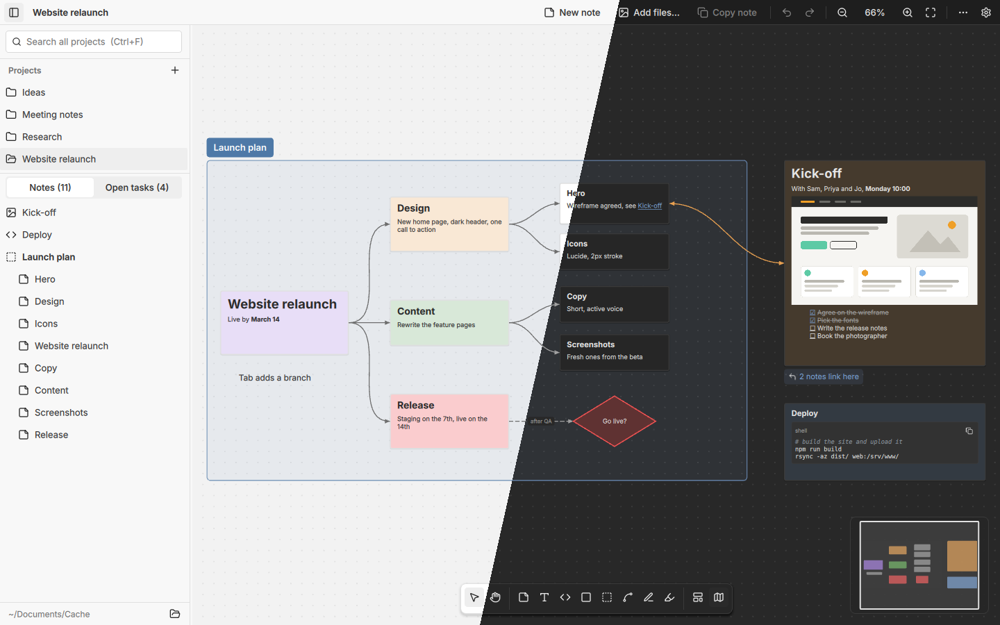

# Cache

Notes on an infinite canvas: Markdown notes with their images and videos,
linked into mindmaps, searched across every project, and copied with their
pictures into Teams or mail.

**[Website](https://iam-peter.github.io/cache/)** ·
**[Download](https://github.com/iam-peter/cache/releases)** ·
[Nightly](https://github.com/iam-peter/cache/releases/tag/nightly)



Built with Qt 6 (C++ and Qt Quick). Each project is a folder, each note a
plain Markdown file. A sidebar lists your projects and the notes on the
current canvas. The look comes from [igitt](https://github.com/iam-peter/igitt):
its Qt Quick Controls style, themes, fonts and icons.

## Download

Each [release](https://github.com/iam-peter/cache/releases) has:

| File | For |
|---|---|
| `cache-windows-x64-setup.exe` | Windows 10/11: installer, no administrator rights needed |
| `cache-windows-x64.zip` | Windows 10/11 without installing: unzip, start `cache.exe` |
| `cache-macos.dmg` | macOS, Apple silicon and Intel |
| `cache-linux-x64.AppImage` | any Linux |
| `cache-linux-x64.deb` | Debian and Ubuntu, with its own Qt |

The programs aren't signed: Windows SmartScreen asks once (*More info*,
*Run anyway*). macOS blocks the first start; then choose *Open Anyway*
under System Settings › Privacy & Security. Step-by-step guides for every
system are on the [website](https://iam-peter.github.io/cache/#installation).

**Windows installer.** It puts the program into a fixed folder
(`%LOCALAPPDATA%\Programs\Cache`, or Program Files when installed for all
users), offers two checkboxes for a Start menu entry and a desktop shortcut
(both ticked) and registers an uninstaller under Windows' *Apps*. Neither
updating nor uninstalling touches the notes.

**Nightly and releases.** Every night with new commits, the
[Nightly](.github/workflows/nightly.yml) workflow builds and tests on Linux,
Windows and macOS, smoke-tests the packages and replaces the rolling
`nightly` pre-release. *Promote Release* (run by hand with a version)
turns the current nightly into a stable release with the same files.
[CI](.github/workflows/ci.yml) builds and tests every push and pull
request; the [website](pages/) is published from `pages/` by the
*Website* workflow.

## Features

- **Infinite canvas**: zoom with the wheel or a pinch, pan with `Space`+drag,
  the middle button or the hand tool, fit everything with `Ctrl+1` and
  the selection with `Ctrl+2`. A minimap in the corner shows where you
  are.
- **Tools, as in FigJam** (along the bottom): select, pan, note, text,
  code snippet, shapes (rectangle, ellipse, diamond, triangle), section,
  connector, pen and highlighter, each with a one-letter key (`F1`).
- **Selecting and arranging**: drag on empty space to select several
  (Shift adds), `Ctrl+A` for all. Move them together with smart guides
  that snap to other items' edges and centres (Alt moves freely); align
  and space them evenly, colour, copy, duplicate or delete them at once.
- **Markdown notes**: double-click a note to edit it, `Esc` to finish.
  Notes render headings, lists, tables, links, images, videos and code,
  and grow to fit when you finish editing. Each note is a plain `.md`
  file.
- **Checklists**: `- [ ]` tasks are boxes to tick right in the note. The
  sidebar's **Open tasks** tab lists every unticked task of every project
  and ticks them there too.
- **Code snippets**: fenced code blocks (`K` for a new snippet,
  `Ctrl+Shift+K` while editing) are syntax-highlighted in the theme's
  colours, with a button to copy the code. The language comes from the
  fence (```` ```python ````) or is guessed.
- **Connectors**: drag from one of a selected item's side handles (or with
  the connector tool) onto another item to connect them, or onto empty
  space for a new connected note. A connector leaves by the side you drag
  it from and enters by the side of the target nearest the pointer (dots
  show which), so left to bottom is as easy as left to right; dragging
  back onto the item you started from connects it to itself. Select a
  connector and drag either end onto another side or another item to
  move it; the route button hands the sides back to the routing.
  Connecting B to A when A already connects to B along the same sides
  turns that connector into one with arrows both ways. Connectors follow
  their items and can be curved, straight or elbowed, have arrows at
  either end or none, be dashed, coloured and labelled (double-click one).
- **Mindmaps**: with a note selected, `Tab` adds a child and `Enter` a
  sibling, ready to type; `Alt`+arrows walk the branches. Fold a branch
  into its root with the badge on its edge, and **Tidy** lays a branch out
  as a tree.
- **Wiki links**: type `[[` in a note for a list of notes of all projects;
  `[[Title]]` links one (`[[Project/Title]]` in another project).
  Hovering a link shows a preview of the note, clicking opens it, and a
  link to a note that doesn't exist yet makes it. A link on a line of its
  own shows a **preview** of the linked note, `![[Title]]`, which its
  chevron hides and shows again. Notes show how many notes link to them;
  links between notes of a canvas can be drawn as dotted lines.
- **Referring to media**: type `@` while writing for a list of the
  images, videos and files of the note, then of the others, each with a
  picture; typing the start of a name (three letters or more) offers it
  too (Tab takes it there, so Enter still starts a new line). A medium's
  name is its alt text, ``, or its file name;
  another note's media go by file name. The entry the list is on is
  marked: its line in the editor, or the other note on the canvas. In
  the note, the names are links: hovering one shows the medium.
- **Sections**: labelled areas (`S`) that take along what lies in them when
  moved. They are the chapters of the sidebar's note list.
- **Shapes, text and pen**: shapes with labels for flowcharts, free text in
  four sizes, pen and highlighter lines, all in the theme's colours.
- **Templates**: Kanban board, retrospective, meeting notes, pros and
  cons, mindmap, flowchart and brainstorm; save any selection as a template
  of your own (kept in the workspace's `.templates` folder).
- **Images, videos and files live inside notes**: paste (`Ctrl+V`) or drop
  them on empty canvas for a new note, onto a note (or with a note
  selected) to add them to it, or into a note being edited to put them at
  the cursor. **Add files…** in the toolbar, or the image button on a note,
  picks them. What arrives from other applications becomes Markdown:
  - **rich text** from Teams, Outlook, Word or web pages keeps its
    headings, bold and italics, links, lists and tables; images in it are
    saved with the note
  - **images and videos** are copied into `assets/` and shown, scaled to
    the note; videos show a still of their first frame and load a player
    when the pointer is over them, so canvases full of videos stay quick,
    and play inside the note (expand for a large player)
  - **any other file** (PDF, Office documents, archives…) is copied into
    `assets/` and attached as a card with its type and size that opens it
  - **cells copied from a spreadsheet**, and CSV files, become a table
  - **web links** get the page's title; **web images** are downloaded,
    in the background (one that can't be had, say behind a sign-in, stays
    a link)
  - Markdown and text files become notes of their own, and notes copied
    from Cache paste back exactly
- **For Teams, mail and documents**:
  - **Copy note** (`Ctrl+C`, or `Ctrl+Shift+C` while editing) puts a note on
    the clipboard as rich text with its images embedded, code as coloured
    blocks and tasks as ☐ and ☑, plus the Markdown for plain-text editors.
    A note that is only one image is also copied as that image; videos
    become a link to the file.
  - **Copy as prompt** (`Ctrl+Alt+C`, or the speech bubble on a note)
    copies the selected notes for Claude or another AI chat, in two
    steps, since a chat's paste takes text or files but never both: first
    the text as text, to edit in the prompt box, its links pointing at the
    attached images and files by name; pressed again for the same notes,
    the images and files themselves, to paste after it. Videos are left
    out.
  - `Ctrl+Shift+C` (or the selection toolbar) copies the selection as a
    picture, at twice the screen's resolution, without selection marks.
  - **⋯ → Export canvas as PNG / PDF** saves the whole canvas (or the
    selection) as a picture or a one-page PDF; **Copy canvas as picture**
    puts it on the clipboard.
- **History**: the workspace folder becomes a git repository of its own (also
  when it lies inside another one), and a little while after changes a
  version of the project is committed. **⋯ → History** (`Ctrl+Shift+H`)
  restores any earlier version; the state before the restore stays a
  version too. Needs git; turn it off in Settings.
- **Project sidebar**: create, rename and trash projects, and see every
  note on the canvas, section by section, in reading order.
- **Full-text search** across all projects: the box at the top of the
  sidebar (`Ctrl+F`) searches every note in every project of the
  workspace, not just the open one. Type words or `"quoted phrases"`; a
  note matches when it has all of them, ignoring case and accents
  (`cafe` finds "Café"). While searching, the sidebar shows the results,
  grouped by project with the open one first, each with a snippet and
  the matches in bold. `↑`/`↓` and `Enter`, or a click, open the note,
  switching project if needed. Matches are highlighted inside the notes,
  and results update as you edit.
- **Typo-tolerant**: words also match with a typo or two, a swapped
  pair of letters counting as one (`deplyo stagign` finds "deploy" and
  "staging"), and while still half-typed (`rolbac` finds "rollback").
  Words of up to 3 letters must match exactly, 4–6 letters may have one
  typo, longer ones two; phrases match exactly. Exact matches rank above
  typo matches.
- **igitt's themes**: Light, Dark, Dracula, Alucard and the four Catppuccin
  flavours, or System. The canvas, note tints and controls all follow the
  theme. Your own themes go in `~/.config/Cache/themes` (format:
  `style/` and igitt's `docs/THEMES.md`).
- Colours, duplicate, copy and paste between canvases, bring to front or
  send to back, resize handles, arrow-key nudging, undo and redo of
  everything, and export of a whole canvas to one Markdown file.

Press `F1` for all shortcuts and `Ctrl+,` for settings.

## Storage

The default workspace is `~/Documents/Cache`; change it from the
sidebar footer. Each project is a plain folder:

```
My Project/
├── canvas.json      every item (notes' place, sections, shapes, text, pen
│                    lines), the connectors, and the last view
├── notes/<id>.md    one Markdown file per note
└── assets/          images and videos the notes embed (copied in on import)
```

Changes save automatically. Notes stay readable in any Markdown editor, and
`.md` files you put into `notes/` yourself show up on the canvas the next
time the project opens. Media cards from earlier versions are turned into
notes holding that media.

## Building

Needs Qt 6.9 or newer (developed against 6.12) with Qt Quick, Quick
Controls 2, Qt Multimedia, Qt Network and Qt SVG, plus CMake 3.21+ and a C++20 compiler.

```bash
cmake -S . -B build -G Ninja -DCMAKE_PREFIX_PATH=$HOME/Qt/6.12.0/gcc_64
```

```bash
cmake --build build
```

```bash
./build/cache
```

For daily use, install a release build next to the debug one in
`build/`; it goes into `~/.local` with an entry in the application menu
and finds the Qt it was built against:

```bash
cmake -S . -B build-release -G Ninja -DCMAKE_BUILD_TYPE=Release -DCMAKE_INSTALL_PREFIX=$HOME/.local -DCMAKE_PREFIX_PATH=$HOME/Qt/6.12.0/gcc_64
```

```bash
cmake --build build-release && cmake --install build-release
```

Run the second command again to update it.

With `CACHE_TRACE_LATENCY=1` set, Cache prints how long each key press
and click takes until a frame showing it is on screen, for checking that
typing stays as quick as in a plain editor.

`--workspace <folder>` opens another workspace for that start without
saving it, and `--grab <png>` saves a screenshot of the window and quits
(the smoke tests of the packages use both). Cache used to be called Note
Canvas: on its first start it takes over Note Canvas' settings, and keeps
using `~/Documents/Note Canvas` if there is no `~/Documents/Cache` yet.

The search's matching, the Markdown and code helpers, the board model and
the history have unit tests:

```bash
ctest --test-dir build --output-on-failure
```

## Layout

| Path | Purpose |
|---|---|
| `style/` | igitt's style module (`IgittStyle`), unchanged from igitt `0238e3b` |
| `fonts/`, `icons/` | Inter and JetBrains Mono (OFL) and Lucide icons (ISC), as in igitt |
| `src/boardmodel.*` | Items and connectors: load/save, undo, media, rendering, rich copy |
| `src/importer.cpp` | What is dropped or pasted, as Markdown: rich text, files, links, cells |
| `src/boardops.cpp` | Several items at once, connectors, mindmaps, sections, templates, export |
| `src/markdown.*` | Tasks, `[[wiki links]]` and code fences in a note's Markdown |
| `src/highlight.*` | Syntax highlighting of code blocks |
| `src/history.*` | Versions of the projects, with git |
| `src/workspace.*` | Project folders in the workspace |
| `src/documentfilter.*` | Reading-order sort of the sidebar's note list |
| `src/searchmodel.*` | Search over all projects; links, backlinks and tasks across them (`Search` in QML) |
| `src/fuzzy.*` | Typo-tolerant matching: accent folding, edit distance |
| `logo/` | The icon (SVG, PNG, ICO, ICNS) and the desktop entry |
| `packaging/` | Debian package, Windows installer, QML imports for the deploy tools |
| `pages/` | The website, published on GitHub Pages |
| `.github/workflows/` | CI, nightly builds, releases and the website |
| `tests/` | Tests of the matching, Markdown and code helpers, board model and history |
| `templates/` | The built-in templates |
| `src/gridbackground.*` | Scene-graph dot grid |
| `src/Fonts.*` | Registers the bundled fonts (from igitt) |
| `qml/Main.qml` | Window, toolbar, shortcuts |
| `qml/Theme.qml` | Canvas colours made from the theme's roles, and preferences |
| `qml/CanvasView.qml` | Pan/zoom, tools, selection, moving with guides, connecting, keys, export |
| `qml/CanvasCard.qml` | Any item: frame, move, resize, handles, folding, floating toolbar |
| `qml/NoteBody.qml` | A rendered note and its editor, with `[[` completion |
| `qml/*Body.qml` | Shapes, text, sections and pen lines |
| `qml/CodeBlock.qml`, `EmbedBlock.qml`, `VideoBlock.qml`, `FileBlock.qml` | Code, link previews, videos and attached files in notes |
| `qml/Connector.qml` | A connector, its route and arrows |
| `qml/ToolPalette.qml`, `Minimap.qml`, `SelectionBar.qml`, `LinkBar.qml` | Tools, map, toolbars for selections and connectors |
| `qml/TemplateDialog.qml`, `HistoryDialog.qml` | Templates and versions |
| `qml/Sidebar.qml`, `SettingsDialog.qml` | Projects and notes; theme, fonts, canvas settings |
| `qml/Icon*.qml`, `SplitterHandle.qml` | Helpers from igitt |

To update the style, copy igitt's `src/style` over `style/`.

## License

MIT, see [LICENSE](LICENSE). Qt is used under the LGPL v3; igitt's style
(`style/`) is MIT; Inter and JetBrains Mono are under the SIL Open Font
License 1.1 and the Lucide icons under the ISC license (their license
files are beside them).
