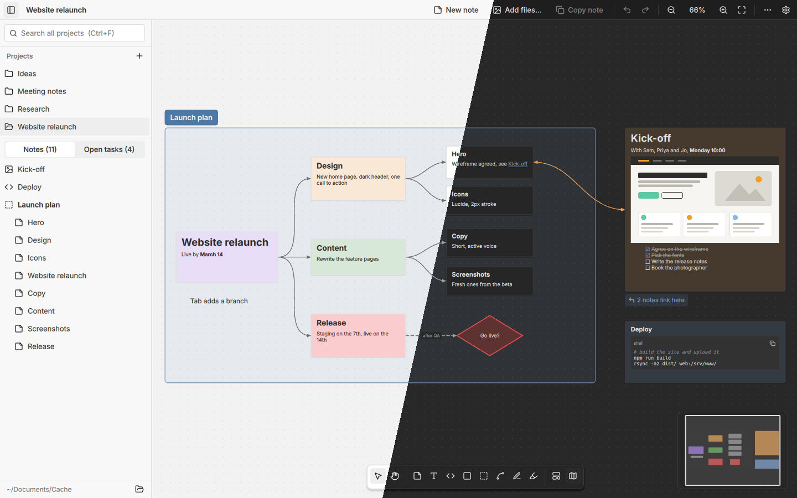

# Cache

Notes on an infinite canvas: Markdown notes with their images and videos,
linked into mindmaps, searched across every project, and copied with their
pictures into Teams or mail.

**[Website](https://iam-peter.github.io/cache/)** ·
**[Download](https://github.com/iam-peter/cache/releases)** ·
[Nightly](https://github.com/iam-peter/cache/releases/tag/nightly)



Built with Qt 6 (C++ and Qt Quick). Each project is a folder, each note a
plain Markdown file. A sidebar lists your projects and the notes on the
current canvas. The look comes from [igitt](https://github.com/iam-peter/igitt):
its Qt Quick Controls style, themes, fonts and icons.

## Download

Each [release](https://github.com/iam-peter/cache/releases) has:

| File | For |
|---|---|
| `cache-windows-x64-setup.exe` | Windows 10/11: installer, no administrator rights needed |
| `cache-windows-x64.zip` | Windows 10/11 without installing: unzip, start `cache.exe` |
| `cache-macos.dmg` | macOS, Apple silicon and Intel |
| `cache-linux-x64.AppImage` | any Linux |
| `cache-linux-x64.deb` | Debian and Ubuntu, with its own Qt |

The programs aren't signed: Windows SmartScreen asks once (*More info*,
*Run anyway*). macOS blocks the first start; then choose *Open Anyway*
under System Settings › Privacy & Security. Step-by-step guides for every
system are on the [website](https://iam-peter.github.io/cache/#installation).

**Windows installer.** It puts the program into a fixed folder
(`%LOCALAPPDATA%\Programs\Cache`, or Program Files when installed for all
users), offers two checkboxes for a Start menu entry and a desktop shortcut
(both ticked) and registers an uninstaller under Windows' *Apps*. Neither
updating nor uninstalling touches the notes.

**Nightly and releases.** Every night with new commits, the
[Nightly](.github/workflows/nightly.yml) workflow builds and tests on Linux,
Windows and macOS, smoke-tests the packages and replaces the rolling
`nightly` pre-release. *Promote Release* (run by hand with a version)
turns the current nightly into a stable release with the same files.
[CI](.github/workflows/ci.yml) builds and tests every push and pull
request; the [website](pages/) is published from `pages/` by the
*Website* workflow.

## Features

- **Infinite canvas**: zoom with the wheel, a pinch, `Ctrl`+wheel or
  `+`/`-`; pan with `Space`+drag, the middle button, the hand tool,
  `Shift`+wheel sideways, or the arrow keys while nothing is selected.
  Fit everything with `Ctrl+1` and the selection with `Ctrl+2`. A minimap
  in the corner shows where you are.
- **Resizing** from any corner or side, as in drawing programs: `Shift`
  keeps the proportions, `Alt` resizes around the middle. The edges snap
  to other items' edges and middles, and to the dot grid if set
  (Settings); `Space` while resizing turns snapping off.
- **Tools, as in FigJam** (along the bottom): select, pan, note, text,
  code snippet, shapes (rectangle, ellipse, diamond, triangle), section,
  connector, pen and highlighter, each with a one-letter key (`F1`). A note,
  code snippet, shape or section takes the size you drag out; a click
  gives the usual size.
- **Selecting and arranging**: drag on empty space to select several
  (Shift adds), `Ctrl+A` for all. Move them together with smart guides
  that snap to other items' edges and centres, and to spacing: the middle
  between two neighbours, the gaps other items keep, and the padding
  inside a section, each shown with its distance (`Space` while moving turns
  snapping off, `Shift` keeps to one direction, `Alt` drags a copy);
  align and space them evenly, arrange them in a row, a column or a grid,
  make them fill the selection's width or height, colour, copy, duplicate
  or delete them at once.
- **Markdown notes**: double-click a note to edit it, `Esc` to finish.
  Notes render headings, lists, tables, links, images, videos and code,
  and grow to fit when you finish editing. Each note is a plain `.md`
  file.
- **Checklists and tasks**: `- [ ]` tasks are boxes to tick right in the
  note, and a whole note can be a task too (the box in its toolbar): it
  gets a box in its corner and fades once done. The sidebar's **Tasks**
  tab lists them all, of every project: open ones first, then the done
  ones, which fold away; ticking or unticking there works too.
- **Code snippets**: fenced code blocks (`K` for a new snippet,
  `Ctrl+Shift+K` while editing) are syntax-highlighted in the theme's
  colours, with a button to copy the code. The language comes from the
  fence (```` ```python ````) or is guessed.
- **Connectors**: drag from one of a selected item's side handles (or with
  the connector tool) onto another item to connect them, or onto empty
  space for a new connected note. A connector leaves by the side you drag
  it from and enters by the side of the target nearest the pointer (dots
  show which), so left to bottom is as easy as left to right; dragging
  back onto the item you started from connects it to itself. Select a
  connector and drag either end onto another side or another item to
  move it; the route button hands the sides back to the routing.
  Connecting B to A when A already connects to B along the same sides
  turns that connector into one with arrows both ways. Connectors follow
  their items and can be curved, straight or elbowed, have arrows at
  either end or none, be dashed, coloured and labelled (double-click one).
- **Mindmaps**: with a note selected, `Tab` adds a child and `Enter` a
  sibling, ready to type; `Alt`+arrows walk the branches. Fold a branch
  into its root with the badge on its edge, and **Tidy** lays a branch out
  as a tree.
- **Wiki links**: type `[[` in a note for a list of notes of all projects;
  `[[Title]]` links one (`[[Project/Title]]` in another project).
  Hovering a link shows a preview of the note, clicking opens it, and a
  link to a note that doesn't exist yet makes it. A link on a line of its
  own shows a **preview** of the linked note, `![[Title]]`, which its
  chevron hides and shows again. `[[Title#Heading]]` links one part of a
  note: its preview shows only that heading and what lies under it
  (typing `#` after a title in `[[` offers its headings). Notes show how many notes link to them;
  links between notes of a canvas can be drawn as dotted lines.
- **Referring to media**: type `@` while writing for a list of the
  images, videos and files of the note, then of the others, each with a
  picture; typing the start of a name (three letters or more) offers it
  too (Tab takes it there, so Enter still starts a new line). A medium's
  name is its alt text, ``, or its file name;
  another note's media go by file name. The entry the list is on is
  marked: its line in the editor, or the other note on the canvas. In
  the note, the names are links: hovering one shows the medium.
- **Sections**: labelled areas (`S`) that take along what lies in them when
  moved. They are the chapters of the sidebar's note list. The chevron on
  a section's title folds it to a strip, hiding what lies in it.
- **Shapes, text and pen**: shapes with labels for flowcharts, free text in
  four sizes, pen and highlighter lines, all in the theme's colours.
- **Templates**: Kanban board, retrospective, meeting notes, pros and
  cons, mindmap, flowchart and brainstorm; save any selection as a template
  of your own (kept in the workspace's `.templates` folder).
- **Images, videos and files live inside notes**: paste (`Ctrl+V`) or drop
  them on empty canvas for a new note, onto a note (or with a note
  selected) to add them to it, or into a note being edited to put them at
  the cursor. **Add files…** in the toolbar, or the image button on a note,
  picks them. What arrives from other applications becomes Markdown:
  - **rich text** from Teams, Outlook, Word or web pages keeps its
    headings, bold and italics, links, lists and tables; images in it are
    saved with the note
  - **images and videos** are copied into `assets/` and shown, scaled to
    the note; videos show a still of their first frame and load a player
    when the pointer is over them, so canvases full of videos stay quick,
    and play inside the note (expand for a large player)
  - **audio** (MP3, WAV, Ogg, Opus, M4A, AAC, FLAC) is attached and plays
    in the note: play and pause, where it is, a bar to seek on
  - **PDFs** are attached and show their pages in the note, one at a time
    with buttons to page through (built with Qt PDF; without it they are
    file cards)
  - **any other file** (PDF, Office documents, archives…) is copied into
    `assets/` and attached as a card with its type and size that opens it
  - **cells copied from a spreadsheet**, and CSV files, become a table
  - **web links** get the page's title, Jira issues their key
    (`[IDS5-1341](…/browse/IDS5-1341)`); **web images** are downloaded,
    in the background (one that can't be had, say behind a sign-in, stays
    a link)
  - Markdown and text files become notes of their own, and notes copied
    from Cache paste back exactly
- **Previews of web links**: resting the pointer on a link in a note
  shows the page's title, description and picture; a Wikipedia article's
  opening lines and lead picture. Pages are read only then, never just
  because a note shows a link.
- **Link cards**: a web address pasted or dropped on empty canvas (or
  **New link card here** in the canvas menu) becomes a card with the
  page's picture, title, description and site; a Jira issue's card shows
  its key, status, summary and fields. The button beside the site, or
  `Ctrl`+click on the title, opens it; double-click changes the address.
  Pasted into a note, an address stays a Markdown link. The eye in a
  card's toolbar chooses what it shows (picture, description, status and
  each field), for that card or for every card of its service; a card
  folds to its title line. Any detail (a ticket's status, a review's
  votes, unresolved comments) can be **pulled out** as a node of its own
  that stays up to date, joined to its card by a dashed line: beside the
  card's section, so folding the section keeps it in sight, and made
  narrow, a traffic light.
- **Linked issues and pages**: with an Atlassian account (Settings,
  Accounts), a link to a Jira issue shows the issue's summary and status
  after it, and its type, priority, assignee and when it changed while
  the pointer is on it; a link to a Confluence page shows its space, an
  excerpt, and who changed it last and when. A bare address in a note
  shows the issue's key or the page's title instead.
- **GitLab** (gitlab.com or your own, with a personal access token with
  the read_api scope): a link to a merge request shows its state, branches,
  author, reviewers and who approved, its pipeline and labels; a pipeline,
  its stages and how their jobs went; a file with lines (`#L40-60`), those
  lines as highlighted code; issues, commits, repositories (their default
  branch's pipeline, languages, latest release), releases, tags, compares,
  milestones (how many issues are closed), wiki pages and snippets too.
  The command palette searches projects, merge requests and issues, and
  lists your open merge requests and those waiting for your review; the
  latter are also at the top of the Tasks tab.
- **GitHub** (github.com or GitHub Enterprise, with a personal access
  token): the same for pull requests (state, branches, author, reviewers,
  who approved or asked for changes, checks, lines added and removed),
  Actions runs and their jobs, files with lines (`#L40-L60`) as code,
  issues, commits, repositories, releases, compares, milestones and gists.
  The command palette searches repositories, pull requests and issues and
  lists your open pull requests and those waiting for your review, which
  are also in the Tasks tab with GitLab's. Without an account, GitHub
  links are read as the web pages they are.
- **Gerrit** (such as codereview.qt-project.org, with your username and
  an HTTP password from Gerrit's Settings, HTTP Credentials): a link to a
  change shows its state, each label's votes, owner, branch, lines
  changed, whose attention it waits for and its unresolved comments; a
  link to a file of a patch set shows its lines. The command palette
  searches changes and lists your open ones and those waiting for your
  review (also in the Tasks tab). A Jira issue's card adds cards of the
  changes naming its key, connected to it.
- **Figma designs**: with a Figma personal access token (Settings,
  Accounts), a link to a frame or component shows it as Figma renders it,
  on its link card and in its hover card, with its name, size and file;
  a link to a file shows its thumbnail and pages. Design files, FigJam
  boards, prototypes, slides and branches alike. The token goes to
  Figma's API only. Renders, like every link card's picture, are kept in
  Cache's cache folder, so they show at once when a project opens; a
  design is rendered again only once its file has changed. Jira Cloud takes your email and an API token from
  id.atlassian.com, which works on every Atlassian Cloud site you can
  see: one sign-in can serve all `*.atlassian.net` sites. Jira Data
  Center takes a personal access token. Links to another address of an
  Atlassian site (a custom domain such as `jira.example.com`) are found
  out by asking that address, without signing in, which site it is;
  both must give the same cloud id. Any other old address can be given
  to the account under **Also for** (`jira.example.com =
  example.atlassian.net` for the all-sites one), and its links are read
  from the new site. The token is kept in the system's
  keychain and sent only to the sites it is for; what the issues say is
  kept in Cache's cache folder, not in the project
- **For Teams, mail and documents**:
  - **Copy note** (`Ctrl+C`, or `Ctrl+Shift+C` while editing) puts a note on
    the clipboard as rich text with its images embedded, code as coloured
    blocks and tasks as ☐ and ☑, plus the Markdown for plain-text editors.
    A note that is only one image is also copied as that image; videos
    become a link to the file.
  - **The Copy menu** (the copy button on a note or a selection, and
    the item menu) also offers **Raw Markdown**, **As image**, and for
    Claude or another AI chat, whose prompt box takes text or files in
    one paste but never both: **Text only**, the text without its images
    and videos, every mention of a medium named after the file **Media
    only** copies; and **Media only**, the images and files as files
    named after the media (`screenshot123.png` for
    ``). Paste one, then the other.
  - `Ctrl+Shift+C` (or the selection toolbar) copies the selection as a
    picture, at twice the screen's resolution, without selection marks.
  - **⋯ → Export a picture…** copies or saves (PNG or one-page PDF) the
    whole canvas, the selection or what's on screen, at 1×, 2× or 3×, and
    if wanted without its text: grey bars instead, to share how a board
    is laid out but not what it says. **Copy canvas as picture** puts the
    whole canvas on the clipboard at once.
- **History**: the workspace folder becomes a git repository of its own (also
  when it lies inside another one), and a little while after changes a
  version of the project is committed. **⋯ → History** (`Ctrl+Shift+H`)
  restores any earlier version; the state before the restore stays a
  version too. Needs git; turn it off in Settings.
- **Project sidebar**: create, rename and trash projects, and see every
  note on the canvas, section by section, in reading order.
- **Full-text search** across all projects: the box at the top of the
  sidebar (`Ctrl+F`) searches every note in every project of the
  workspace, not just the open one. Type words or `"quoted phrases"`; a
  note matches when it has all of them, ignoring case and accents
  (`cafe` finds "Café"). While searching, the sidebar shows the results,
  grouped by project with the open one first, each with a snippet and
  the matches in bold. `↑`/`↓` and `Enter`, or a click, open the note,
  switching project if needed. Matches are highlighted inside the notes,
  and results update as you edit.
- **Typo-tolerant**: words also match with a typo or two, a swapped
  pair of letters counting as one (`deplyo stagign` finds "deploy" and
  "staging"), and while still half-typed (`rolbac` finds "rollback").
  Words of up to 3 letters must match exactly, 4–6 letters may have one
  typo, longer ones two; phrases match exactly. Exact matches rank above
  typo matches.
- **igitt's themes**: Light, Dark, Dracula, Alucard and the four Catppuccin
  flavours, or System. The canvas, note tints and controls all follow the
  theme. Your own themes go in `~/.config/Cache/themes` (format:
  `style/` and igitt's `docs/THEMES.md`).
- **Locking**: the lock on an item's toolbar (or Lock in its menu) keeps
  it from being moved, resized, edited or deleted; its tasks can still be
  ticked. Copies of it aren't locked.
- **Fit to content**: a note's toolbar button makes it exactly as tall as
  what it holds.
- Colours, duplicate, copy and paste between canvases, bring to front or
  send to back, resize handles, arrow-key nudging, undo and redo of
  everything, and export of a whole canvas to one Markdown file.

- **Command palette** (`Ctrl+P`): every command, the notes and sections of
  every project and the projects, by typing part of their name. It also
  asks Jira and Confluence (on the Atlassian sites your notes link to, or
  that have an account of their own) and Figma (the files of the teams
  given under its account) for what you type; Enter adds what they found
  to the canvas as a link card, Shift+Enter opens it in the browser.
- **Boards in boards**: a card of another project (from the command
  palette: type its name, then *Add a card of …*) shows its canvas in
  miniature, with its notes' titles; double-click it to open that project.
- **Following connectors**: a selected connector's toolbar goes to the
  item it comes from or points to, however far away.

Press `F1` for all shortcuts and `Ctrl+,` for settings.

## Storage

The default workspace is `~/Documents/Cache`; change it from the
sidebar footer. Each project is a plain folder:

```
My Project/
├── canvas.json      every item (notes' place, sections, shapes, text, pen
│                    lines), the connectors, and the last view
├── notes/<id>.md    one Markdown file per note
└── assets/          images and videos the notes embed (copied in on import)
```

Changes save automatically. Notes stay readable in any Markdown editor, and
`.md` files you put into `notes/` yourself show up on the canvas the next
time the project opens. Media cards from earlier versions are turned into
notes holding that media.

## Building

Needs Qt 6.9 or newer (developed against 6.12) with Qt Quick, Quick
Controls 2, Qt Multimedia, Qt Network and Qt SVG, plus CMake 3.21+ and a C++20 compiler.
Qt PDF (the Maintenance Tool's "Qt PDF" extension) is optional: with it,
PDFs in notes show their pages.
On Linux, accounts keep their tokens through libsecret (`libsecret-1-dev`);
without it Cache builds, but can't keep accounts.

```bash
cmake -S . -B build -G Ninja -DCMAKE_PREFIX_PATH=$HOME/Qt/6.12.0/gcc_64
```

```bash
cmake --build build
```

```bash
./build/cache
```

For daily use, install a release build next to the debug one in
`build/`; it goes into `~/.local` with an entry in the application menu
and finds the Qt it was built against:

```bash
cmake -S . -B build-release -G Ninja -DCMAKE_BUILD_TYPE=Release -DCMAKE_INSTALL_PREFIX=$HOME/.local -DCMAKE_PREFIX_PATH=$HOME/Qt/6.12.0/gcc_64
```

```bash
cmake --build build-release && cmake --install build-release
```

Run the second command again to update it.

With `CACHE_TRACE_LATENCY=1` set, Cache prints how long each key press
and click takes until a frame showing it is on screen, for checking that
typing stays as quick as in a plain editor.

`--workspace <folder>` opens another workspace for that start without
saving it, and `--grab <png>` saves a screenshot of the window and quits
(the smoke tests of the packages use both). Cache used to be called Note
Canvas: on its first start it takes over Note Canvas' settings, and keeps
using `~/Documents/Note Canvas` if there is no `~/Documents/Cache` yet.

The search's matching, the Markdown and code helpers, the board model and
the history have unit tests:

```bash
ctest --test-dir build --output-on-failure
```

## Layout

| Path | Purpose |
|---|---|
| `style/` | igitt's style module (`IgittStyle`), unchanged from igitt `0238e3b` |
| `fonts/`, `icons/` | Inter and JetBrains Mono (OFL) and Lucide icons (ISC), as in igitt |
| `src/boardmodel.*` | Items and connectors: load/save, undo, media, rendering, rich copy |
| `src/importer.cpp` | What is dropped or pasted, as Markdown: rich text, files, links, cells |
| `src/boardops.cpp` | Several items at once, connectors, mindmaps, sections, templates, export |
| `src/markdown.*` | Tasks, `[[wiki links]]` and code fences in a note's Markdown |
| `src/highlight.*` | Syntax highlighting of code blocks |
| `src/history.*` | Versions of the projects, with git |
| `src/workspace.*` | Project folders in the workspace |
| `src/documentfilter.*` | Reading-order sort of the sidebar's note list |
| `src/searchmodel.*` | Search over all projects; links, backlinks and tasks across them (`Search` in QML) |
| `src/fuzzy.*` | Typo-tolerant matching: accent folding, edit distance |
| `src/links.*` | Details of web links from their services (`Links` in QML), the resolvers' interface, accounts |
| `src/jiraresolver.*` | Jira issues, through Jira's REST API; signs in the Atlassian accounts |
| `src/confluenceresolver.*` | Confluence pages, through Confluence's REST API, with the same accounts |
| `src/figmaresolver.*` | Figma frames and files, through Figma's REST API, rendered as pictures |
| `src/gitlabresolver.*` | GitLab merge requests, pipelines, files, issues, commits and more, through its REST API |
| `src/githubresolver.*` | GitHub pull requests, Actions runs, files, issues, commits and more, through its REST API |
| `src/pageresolver.*` | Any web page's title, description and picture, for link and hover cards |
| `src/wikipediaresolver.*` | Wikipedia articles' opening lines and pictures |
| `src/keychain.*` | Tokens in the system's keychain: libsecret, macOS Keychain, Windows Credential Manager |
| `logo/` | The icon (SVG, PNG, ICO, ICNS) and the desktop entry |
| `packaging/` | Debian package, Windows installer, QML imports for the deploy tools |
| `pages/` | The website, published on GitHub Pages |
| `.github/workflows/` | CI, nightly builds, releases and the website |
| `tests/` | Tests of the matching, Markdown and code helpers, board model, links and history |
| `templates/` | The built-in templates |
| `src/gridbackground.*` | Scene-graph dot grid |
| `src/Fonts.*` | Registers the bundled fonts (from igitt) |
| `qml/Main.qml` | Window, toolbar, shortcuts |
| `qml/Theme.qml` | Canvas colours made from the theme's roles, and preferences |
| `qml/CanvasView.qml` | Pan/zoom, tools, selection, moving with guides, connecting, keys, export |
| `qml/CanvasCard.qml` | Any item: frame, move, resize, handles, folding, floating toolbar |
| `qml/NoteBody.qml` | A rendered note and its editor, with `[[` completion |
| `qml/*Body.qml` | Shapes, text, sections and pen lines |
| `qml/CodeBlock.qml`, `EmbedBlock.qml`, `VideoBlock.qml`, `AudioBlock.qml`, `PdfBlock.qml`, `FileBlock.qml` | Code, link previews, videos, audio, PDFs and attached files in notes |
| `qml/LinkBody.qml` | A link card: a web page or an issue |
| `qml/ExportDialog.qml`, `Redacted.qml` | Exporting pictures; text as grey bars for privacy |
| `qml/CommandPalette.qml` | Ctrl+P: commands, notes, sections, projects, and Jira, Confluence and Figma |
| `qml/BoardBody.qml` | A card of another project, its canvas in miniature |
| `qml/Connector.qml` | A connector, its route and arrows |
| `qml/ToolPalette.qml`, `Minimap.qml`, `SelectionBar.qml`, `LinkBar.qml` | Tools, map, toolbars for selections and connectors |
| `qml/TemplateDialog.qml`, `HistoryDialog.qml` | Templates and versions |
| `qml/Sidebar.qml`, `SettingsDialog.qml` | Projects and notes; theme, fonts, canvas settings, accounts |
| `qml/Icon*.qml`, `SplitterHandle.qml` | Helpers from igitt |

To update the style, copy igitt's `src/style` over `style/`.

## License

MIT, see [LICENSE](LICENSE). Qt is used under the LGPL v3; igitt's style
(`style/`) is MIT; Inter and JetBrains Mono are under the SIL Open Font
License 1.1 and the Lucide icons under the ISC license (their license
files are beside them).
